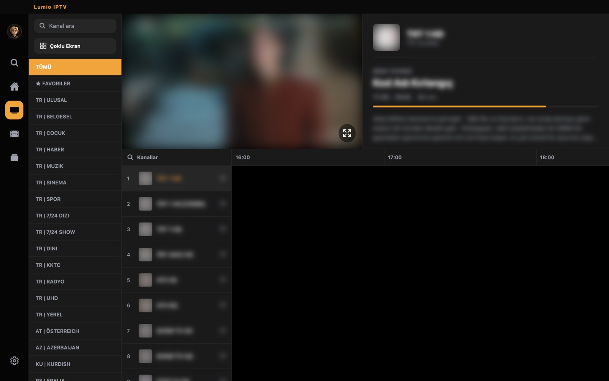
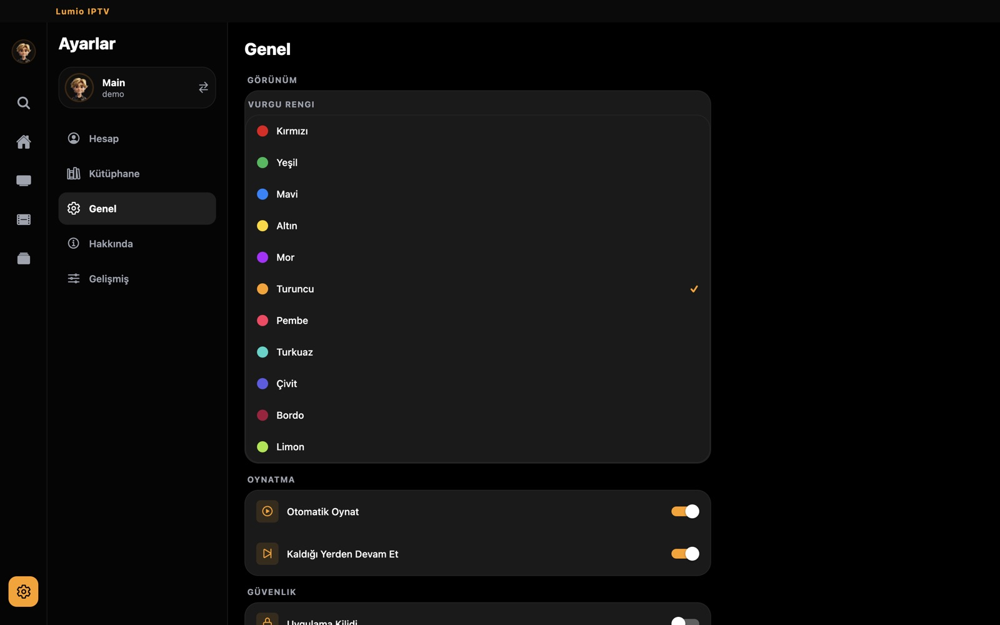

# Lumio IPTV

**Kendi IPTV listeni sinema keyfiyle izle.** Mac, Windows, Android ve Android TV için hızlı, şık ve ücretsiz bir IPTV oynatıcı.

**[⬇ Son sürümü indir](../../releases/latest)** · **[Kaynak kod (MIT)](https://github.com/future01software/lumio-iptv)**

## Neden Lumio?

- **Donmayan canlı yayın.** Takılan yayını kendiliğinden toparlar; kanal değiştirip geri dönmene gerek kalmaz. Yavaş sağlayıcılarda bile 1080p akıcı oynar.
- **Xtream Codes ve M3U.** Sağlayıcının bilgilerini gir ya da liste bağlantını yapıştır; hepsi bu.
- **Canlı TV + yayın akışı (EPG).** Kategoriler, favoriler, şu an ne yayında, sıradaki programa hatırlatıcı.
- **Filmler ve diziler.** Afişli kütüphane, kaldığın yerden devam, sezon ve bölüm listesi.
- **Çoklu ekran.** 2 ya da 4 kanalı aynı anda izle; ses seçtiğin ekrandan gelir.
- **Profiller.** Ailedeki herkese ayrı profil, çocuk profili ve PIN kilidi.
- **Yedekle ve taşı.** Profil, favori, geçmiş ve ayarları tek dosyayla başka cihaza aktar.
- **Otomatik güncelleme.** Yeni sürüm çıkınca uygulama kendisi haber verir.

| Canlı TV | Filmler |
|---|---|
|  |  |
| **Diziler** | **Ayarlar** |
|  |  |

## İndir

[Releases](../../releases/latest) sayfasından cihazına uygun dosyayı seç:

| Platform | Dosya |
|---|---|
| macOS | `Lumio-IPTV-<sürüm>.dmg` |
| Windows | `Lumio-IPTV-<sürüm>.msi` |
| Android / Android TV (64-bit, çoğu cihaz) | `Lumio-IPTV-<sürüm>-arm64-v8a.apk` |
| Android TV kutuları (32-bit) | `Lumio-IPTV-<sürüm>-armeabi-v7a.apk` |
| Emin değilsen | `Lumio-IPTV-<sürüm>-universal.apk` |

**Windows ve Android:** 1.1.11 kurulum dosyaları hazırlanıyor; o zamana kadar [1.1.7 sürümünü](../../releases/tag/v1.1.7) indir. Kurduğunda yeni sürüm çıkınca uygulama kendisi güncellenir.

**Mac'te ilk açılış:** Uygulama Apple tarafından imzalanmadığı için ilk seferde Finder'da sağ tıklayıp **Aç**'ı seç.

## Not

Lumio yalnızca bir oynatıcıdır; içinde kanal, film ya da dizi yoktur. Kendi yasal IPTV aboneliğinin bilgilerini girerek kullanırsın. Ekran görüntülerindeki içerikler bu yüzden bulanıklaştırılmıştır.

---

*English:* Lumio IPTV is a fast, free IPTV player for macOS, Windows, Android and Android TV. It supports Xtream Codes and M3U playlists, live TV with EPG, movies and series, multi-view, profiles and auto-update. It ships with no content: bring your own legal subscription. [Download the latest release](../../releases/latest). Open source under MIT: [future01software/lumio-iptv](https://github.com/future01software/lumio-iptv).

Installed apps check this repository for updates automatically (`latest.json`).
